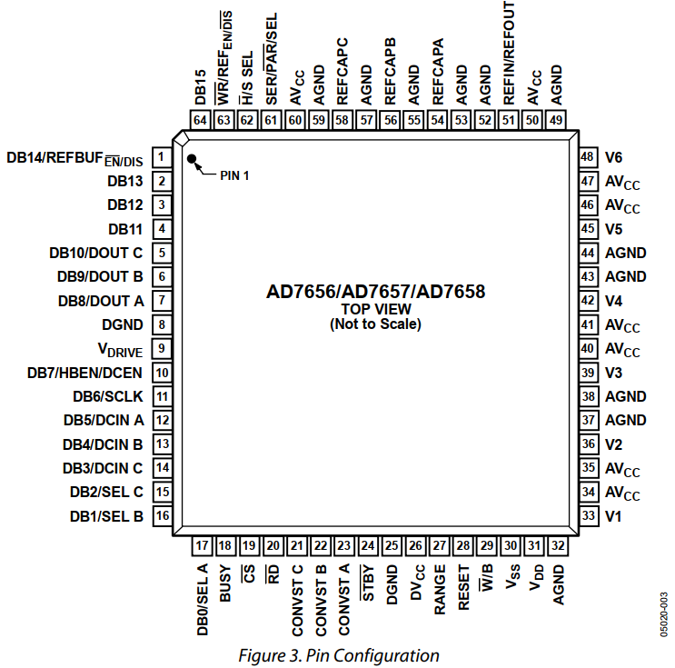
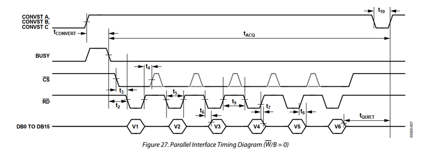
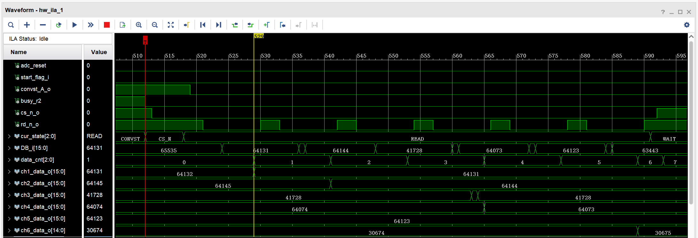
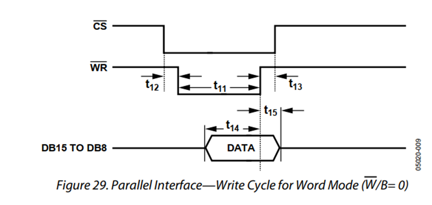

[toc]

---

**本文主要记录笔者`AD7656`的调试记录。**

---

# 芯片主要功能

## 6路低速ADC模拟电压采集

1. 各路电压范围可设为`± 10v`或`± 5v`;

2. 各路电压数据支持`8bit`或`16bit`输出;

---

# 主要管脚介绍

管脚总览如下：



1. 28管脚`RESET`:芯片复位信号，高电平时芯片处于复位状态；

2. 23,22,21管脚`CONVST A,CONVST B,CONVST C`:ADC转化开始信号，A,B,C分别对应V1和V2,V3和V4,V5和V6,CONVST X从低变高时开始转换，复位时该管脚需拉高；

3. 18管脚`BUSY`:拉高代表ADC正处于转换状态，转化完成后拉低，通常转化时间为3us；

4. 29管脚$\overline{W}$/B:低电平选择DB[15:0]，高电平选DB[15:8]；

5. 61管脚SER/$\overline{PAR}$/SEL:低电平选并行接口，高电平选串行接口，一般选并行接口，即低电平；

6. 62管脚$\overline{H}$/S SEL:并行接口模式下，拉低时，V1~V6的开始转化与否由CONVST X决定，拉高时，由配置的寄存器决定；

7. 24管脚$\overline{STBY}$:拉低使芯片处于休眠状态，拉高解除休眠；

---

# 控制时序

## 读操作

官方给出的时序如下：



1. 拉高`CONVST X`，开始传输；

2. 拉高`CONVST X`后，`BUSY`会拉高3us；

3. `BUSY`拉低后，可开始通过`cs`和`rd`信号读取芯片数据，`rd`下降沿后的45ns/36ns(根据`V driver`电压值决定)后读取的数据有效，为便于理解，在`rd`的上升沿读取总线数据即可。`rd`低电平需至少保持45ns/36ns，`rd`高电平需至少保持6ns，依次读取6路电压后，进入退出状态；

4. 采集完最后V6后，需至少等待150ns，该时间内芯片内部在准备下一次转换操作；

5. 退出状态时，`CONVST X`需拉低至少25ns，此后才能结束本次读操作，并且可以进行下一次读操作；

总结以上，读操作时序图如下，一次读操作的总时间至少为3.55us(一般大于该值)；



## 写操作

写操作主要用于软件模式下($\overline{H}$/S SEL拉高)的寄存器配置，官方给出的时序如下：



拉低`cs`和`wr`开始写操作，wr需在低电平持续至少15ns，cs需在wr拉高后至少5ns后拉高，数据应该在cs为低时保持不变。

---

# 换算关系

设采集的16bit总线上的数据为：x = DB[15:0]，则：
当X >= 32768时，实际电压值为：$2 * V_{ref} * (x - 65536) / 65536$（负数）；
当X < 32768时，实际电压值为：$2 * V_{ref} * x / 65536$（正数）；

---

# 相关Verilog代码

## 读驱动

```verilog
`timescale 1ns / 1ps

module ad7656_rd_driver (
    input                               sys_clk_i                  ,// clk100m
    input                               rst_n_i                    ,
    // 开始标志
    input                               start_flag_i               ,// 单周期信号
    // 
    output reg                          convst_A_o                 ,
    output reg                          convst_B_o                 ,
    output reg                          convst_C_o                 ,

    input                               BUSY_i                     ,

    output reg                          cs_n_o                     ,
    output reg                          rd_n_o                     ,
    output                              adc_reset                  ,

    input              [  15: 0]        DB_i                       ,

    output reg         [  15: 0]        ch1_data_o                 ,
    output reg         [  15: 0]        ch2_data_o                 ,
    output reg         [  15: 0]        ch3_data_o                 ,
    output reg         [  15: 0]        ch4_data_o                 ,
    output reg         [  15: 0]        ch5_data_o                 ,
    output reg         [  15: 0]        ch6_data_o                 ,

    output                              convst_done_o               // 完成信号, 拉高一周期
);
// ********************************************************************************** // 
//---------------------------------------------------------------------
// declaration
//---------------------------------------------------------------------
    localparam                          IDLE                      = 0     ;
    localparam                          CONVST                    = 1     ;
    localparam                          CS_N                      = 2     ;
    localparam                          READ                      = 3     ;
    localparam                          WAIT                      = 4     ;
    localparam                          DONE                      = 5     ;
    localparam                          time_4us                  = 400   ;

    reg                [   2: 0]        cur_state                  ;
    reg                                 busy_r1,busy_r2            ;
    reg                [   3: 0]        period_cnt                 ;
    reg                [   2: 0]        data_cnt                   ;
    reg                [  19: 0]        clk_cnt                    ;

    assign                              adc_reset                 = ~rst_n_i;

    assign                              convst_done_o             = (cur_state == DONE) && (period_cnt == 'd7);
// ********************************************************************************** // 
//---------------------------------------------------------------------
// main code
//---------------------------------------------------------------------
// 状态机
always@(posedge sys_clk_i or negedge rst_n_i)begin
    if(!rst_n_i)
        cur_state <= IDLE;
    else case(cur_state)
        IDLE:
            if(start_flag_i)
                cur_state <= CONVST;
            else
                cur_state <= IDLE;
        CONVST:
            if(clk_cnt >= time_4us - 1)
                cur_state <= IDLE;
            else if(~busy_r1 && busy_r2)
                cur_state <= CS_N;
            else
                cur_state <= CONVST;
        CS_N:
            if(period_cnt == 'd5)
                cur_state <= READ;
            else
                cur_state <= CS_N;
        READ:
            if(data_cnt == 'd6 && period_cnt == 'd0)
                cur_state <= WAIT;
            else
                cur_state <= READ;
        WAIT:
            if(data_cnt == 'd2 && period_cnt == 'd4)
                cur_state <= DONE;
            else
                cur_state <= WAIT;
        DONE:
            if(period_cnt == 'd7)
                cur_state <= IDLE;
            else
                cur_state <= DONE;
        default: cur_state <= IDLE;
    endcase
end
always@(posedge sys_clk_i)begin
    case (cur_state)
        CONVST: clk_cnt <= clk_cnt + 'd1;
        default: clk_cnt <= 'd0;
    endcase
end
// 打个拍
always@(posedge sys_clk_i)begin
    busy_r1 <= BUSY_i;
    busy_r2 <= busy_r1;
end
// 转换
always@(posedge sys_clk_i or negedge rst_n_i)begin
    if(!rst_n_i) begin
        convst_A_o <= 'd1;
        convst_B_o <= 'd1;
        convst_C_o <= 'd1;
    end
    else case (cur_state)
        IDLE,DONE,READ,WAIT: begin
            convst_A_o <= 'd0;
            convst_B_o <= 'd0;
            convst_C_o <= 'd0;
        end
        default: begin
            convst_A_o <= 'd1;
            convst_B_o <= 'd1;
            convst_C_o <= 'd1;
        end
    endcase
end
// 读状态时钟计数器
always@(posedge sys_clk_i or negedge rst_n_i)begin
    if(!rst_n_i)
        period_cnt <= 'd0;
    else case (cur_state)
        CS_N:
            if(period_cnt == 'd5)
                period_cnt <= 'd0;
            else
                period_cnt <= period_cnt + 'd1;
        READ,WAIT,DONE:
            if(period_cnt == 'd11)
                period_cnt <= 'd0;
            else
                period_cnt <= period_cnt + 'd1;
        default: period_cnt <= 'd0;
    endcase
end
// 读状态数据计数器
always@(posedge sys_clk_i or negedge rst_n_i)begin
    if(!rst_n_i)
        data_cnt <= 'd0;
    else case (cur_state)
        READ:
            if(data_cnt == 'd6 && period_cnt == 'd10)
                data_cnt <= 'd0;
            else if(period_cnt == 'd10)
                data_cnt <= data_cnt + 'd1;
            else
                data_cnt <= data_cnt;
        WAIT:
            if(period_cnt == 'd2)
                data_cnt <= data_cnt + 'd1;
            else
                data_cnt <= data_cnt;
        default: data_cnt <= 'd0;
    endcase
end
// cs_n
always@(posedge sys_clk_i)begin
    case (cur_state)
        CS_N,READ: cs_n_o <= 'd0;
        default: cs_n_o <= 'd1;
    endcase
end
// rd_n
always@(posedge sys_clk_i)begin
    case (cur_state)
        READ:
            case (period_cnt)
                2,3,4,5,6,7,8,9,10: rd_n_o <= 'd0;
                default: rd_n_o <= 'd1;
            endcase
        default: rd_n_o <= 'd1;
    endcase
end

always@(posedge sys_clk_i or negedge rst_n_i)begin
    if(!rst_n_i)begin
        ch1_data_o <= 'd0;
        ch2_data_o <= 'd0;
        ch3_data_o <= 'd0;
        ch4_data_o <= 'd0;
        ch5_data_o <= 'd0;
        ch6_data_o <= 'd0;
    end
    else case (cur_state)
        READ: if (period_cnt == 'd10) begin
            case (data_cnt)
                0: ch1_data_o <= DB_i;
                1: ch2_data_o <= DB_i;
                2: ch3_data_o <= DB_i;
                3: ch4_data_o <= DB_i;
                4: ch5_data_o <= DB_i;
                5: ch6_data_o <= DB_i;
                default: begin
                    ch1_data_o <= ch1_data_o;
                    ch2_data_o <= ch2_data_o;
                    ch3_data_o <= ch3_data_o;
                    ch4_data_o <= ch4_data_o;
                    ch5_data_o <= ch5_data_o;
                    ch6_data_o <= ch6_data_o;
                end
            endcase
        end
        else begin
            ch1_data_o <= ch1_data_o;
            ch2_data_o <= ch2_data_o;
            ch3_data_o <= ch3_data_o;
            ch4_data_o <= ch4_data_o;
            ch5_data_o <= ch5_data_o;
            ch6_data_o <= ch6_data_o;
        end
        default: begin
            ch1_data_o <= ch1_data_o;
            ch2_data_o <= ch2_data_o;
            ch3_data_o <= ch3_data_o;
            ch4_data_o <= ch4_data_o;
            ch5_data_o <= ch5_data_o;
            ch6_data_o <= ch6_data_o;
        end
    endcase
end
// ********************************************************************************** // 
//---------------------------------------------------------------------
// debug
//---------------------------------------------------------------------
ila_ad7656_rd_driver ila_ad7656_rd_driver_inst (
    .clk                                (sys_clk_i                 ),// input wire clk

    .probe0                             (start_flag_i              ),// input wire [0:0]  probe0  
    .probe1                             (cur_state                 ),// input wire [2:0]  probe1 
    .probe2                             (busy_r2                   ),// input wire [0:0]  probe2 
    .probe3                             (period_cnt                ),// input wire [3:0]  probe3 
    .probe4                             (data_cnt                  ),// input wire [2:0]  probe4 
    .probe5                             (convst_A_o                ),// input wire [0:0]  probe5 
    .probe6                             (cs_n_o                    ),// input wire [0:0]  probe6 
    .probe7                             (rd_n_o                    ),// input wire [0:0]  probe7 
    .probe8                             (DB_i                      ),// input wire [15:0]  probe8 
    .probe9                             (ch1_data_o                ),// input wire [15:0]  probe9 
    .probe10                            (ch2_data_o                ),// input wire [15:0]  probe10 
    .probe11                            (ch3_data_o                ),// input wire [15:0]  probe11 
    .probe12                            (ch4_data_o                ),// input wire [15:0]  probe12 
    .probe13                            (ch5_data_o                ),// input wire [15:0]  probe13 
    .probe14                            (ch6_data_o                ),// input wire [15:0]  probe14 
    .probe15                            (convst_done_o             ) // input wire [0:0]  probe15
);

endmodule
```

## 写驱动

```verilog
`timescale 1ns / 1ps

module ad7656_wr_driver (
    input                               sys_clk_i                  ,// clk100m
    input                               rst_n_i                    ,
    // 开始标志
    input                               wr_flag_i                  ,// 单周期信号
    input              [   7: 0]        wr_data_i                  ,
    output                              bus_busy_o                 ,

    output reg                          wr_n_o                     ,
    output reg                          cs_n_o                     ,

    output             [  15: 0]        DB_o                        
);
// ********************************************************************************** // 
//---------------------------------------------------------------------
// declarations
//---------------------------------------------------------------------
    localparam                          IDLE                      = 0     ;
    localparam                          WRITE                     = 1     ;

    reg                [   0: 0]        next_state                 ;
    reg                [   0: 0]        cur_state                  ;
    reg                [   1: 0]        period_cnt                 ;

    reg                [   7: 0]        data_out                   ;
// ********************************************************************************** // 
//---------------------------------------------------------------------
// logic
//---------------------------------------------------------------------
// 第一段,状态跳转,时序逻辑
always@(posedge sys_clk_i or negedge rst_n_i)begin
    if(!rst_n_i)
        cur_state <= IDLE;
    else
        cur_state <= next_state;
end

// 第二段,跳转条件,组合逻辑
always@(*)begin
    case(cur_state)
        IDLE:
            if(wr_flag_i)
                next_state <= WRITE;
            else
                next_state <= IDLE;
        WRITE:
            if(period_cnt == 'd3)
                next_state <= IDLE;
            else
                next_state <= WRITE;
        default:next_state <= IDLE;
    endcase
end

always@(posedge sys_clk_i)begin
    case (cur_state)
        WRITE: period_cnt <= period_cnt + 'd1;
        default: period_cnt <= 'd0;
    endcase
end

always@(posedge sys_clk_i)begin
    case (cur_state)
        WRITE: cs_n_o <= 'd0;
        default: cs_n_o <= 'd1;
    endcase
end

always@(posedge sys_clk_i)begin
    case (cur_state)
        WRITE:
            case (period_cnt)
                1,2: wr_n_o <= 'd0;
                default: wr_n_o <= 'd1;
            endcase
        default: wr_n_o <= 'd1;
    endcase
end

always@(posedge sys_clk_i or negedge rst_n_i)begin
    if(!rst_n_i)
        data_out <= 'd0;
    else if(wr_flag_i)
        data_out <= wr_data_i;
end

    assign                              DB_o                      = {data_out,8'hff};

    assign                              bus_busy_o                = (cur_state == WRITE);
    
endmodule
```