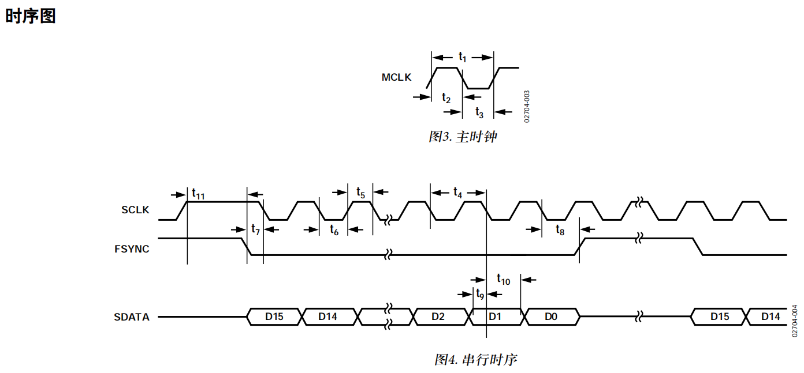
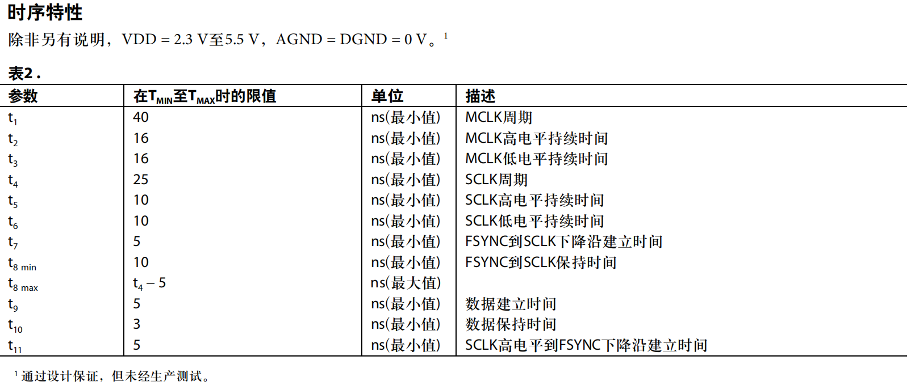
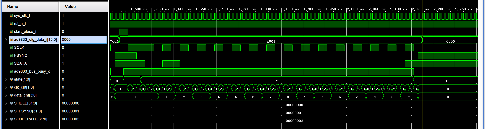
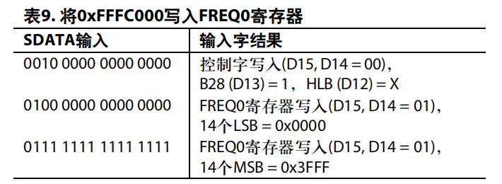

[toc]

---

**本文主要记录笔者`AD9833`的开发记录。**

---

# 芯片DATASHEET介绍

对于`AD9833`芯片手册的解读，包括芯片功能、引脚功能、芯片参数、芯片寄存器、芯片注意事项等等。可以去看网上已有的文章，链接如下，讲的很详细，本文主要该芯片的Verilog驱动程序实现。

[AD9833介绍与应用（C语言实现）](http://t.csdnimg.cn/enV2G)


---

# 控制时序

## 驱动层时序

官方时序手册如下：





总结如下：

1. 参考时钟`MCLK`支持最大25MHz。

2. 串行控制时序的驱动时钟`SCLK`支持最大40MHz。

3. `FCLK`下降沿且`SCLK`为高电平时，开始一个字的写操作。

4. 对AD芯片而言，在`SCLK`下降沿的时候采集总线`SDATA`上的数据，对`FPGA`这种主机而言，在`SCLK`上升沿更新数据即可。

驱动时序如下图：



## 控制字时序

`AD9833`这块芯片用于产生各种波形，通过频率字（16bit）来控制。

例如：假设MCLK为25MHz，需要将该芯片产生3KHz的正弦波，相位不限，我们需要以下操作：

1. 根据$f_{MCLK}/2^{28} \times FREQREG = 3000$可得频率字`FREQREG` = 28'd32_212。

2. 可根据如下官方示例，写入`FREQ0` 28'd32_212。



3. 若需产生其他波形，可仔细查看该芯片的控制字命令含义，这里有中文也有英文的，非常好理解如何配置，本次主要给出设计速率及参考Verilog示例。

[AD9833官方中文说明手册](https://www.analog.com/media/cn/technical-documentation/data-sheets/AD9833_cn.pdf)

# Verilog代码实现(以产生3KHz的正弦波为例)

## 驱动层模块

该部分用于实现基本类SPI的驱动时序：

```verilog
`timescale 1ns / 1ps
// ********************************************************************************** // 
// Company:               
// Engineer:              xiaoxin2ciyuan
// 
// File name:             ad9833_engine
// Create Date:           2024/07/20 18:29:48
// Version:               V1.0
// PATH:                  
// Descriptions:          
// 
// ********************************************************************************** // 
`default_nettype none


module ad9833_engine (
    input  wire                         sys_clk_i                  ,// clk100m
    input  wire                         rst_n_i                    ,

    input  wire                         start_pluse_i              ,

    input  wire        [  15: 0]        ad9833_cfg_data_i          ,// 3k hz . sin(x)

    output reg                          SCLK                       ,// max clk40m
    output reg                          FSYNC                      ,
    output reg                          SDATA                      ,

    output wire                         ad9833_bus_busy_o           
);

    localparam                          S_IDLE                    = 0     ;
    localparam                          S_FSYNC                   = 1     ;
    localparam                          S_OPERATE                 = 2     ;

    reg                [   1: 0]        state                      ;

    reg                [   1: 0]        clk_cnt                    ;
    reg                [   3: 0]        data_cnt                   ;

    assign                              ad9833_bus_busy_o         = ~(state == S_IDLE);

always@(posedge sys_clk_i)begin
    if (!rst_n_i)
        state <= S_IDLE;
    else case (state)
        S_IDLE:
            if(start_pluse_i)
                state <= S_FSYNC;
        S_FSYNC:
            if(clk_cnt == 'd3)
                state <= S_OPERATE;
        S_OPERATE:
            if(clk_cnt == 'd2 && data_cnt == 'd15)
                state <= S_IDLE;
        default:state <= S_IDLE;
    endcase
end

always@(posedge sys_clk_i)begin
    case (state)
        S_FSYNC: clk_cnt <= clk_cnt + 'd1;
        S_OPERATE: clk_cnt <= clk_cnt + 'd1;
        default: clk_cnt <= 'd0;
    endcase
end

always@(posedge sys_clk_i)begin
    case (state)
        S_OPERATE:
            if(clk_cnt == 'd3)
                data_cnt <= data_cnt + 'd1;
        default: data_cnt <= 'd0;
    endcase
end

always@(posedge sys_clk_i)begin
    case (state)
        S_FSYNC: SCLK <= 'd1;
        S_OPERATE:
            case (clk_cnt)
                0: SCLK <= 'd1;
                1: SCLK <= 'd1;
                2: SCLK <= 'd0;
                3: SCLK <= 'd0;
                default: SCLK <= 'd1;
            endcase
        default: SCLK <= 'd0;
    endcase
end

always@(posedge sys_clk_i)begin
    case (state)
        S_FSYNC:
            case (clk_cnt)
                2,3: FSYNC <= 'd0;
                default: FSYNC <= 'd1;
            endcase
        S_OPERATE: FSYNC <= 'd0;
        default: FSYNC <= 'd1;
    endcase
end

always@(posedge sys_clk_i)begin
    case (state)
        S_OPERATE: SDATA <= ad9833_cfg_data_i[15-data_cnt];
        default: SDATA <= 'd1;
    endcase
end
endmodule


`default_nettype wire
```

## 控制字模块

该部分用于实现控制字的开始与结束时序，即频率字、相位字等。

```verilog
`timescale 1ns / 1ps
// ********************************************************************************** // 
// Company:               
// Engineer:              xiaoxin2ciyuan
// 
// File name:             ad9833_ctrl
// Create Date:           2024/07/20 18:29:48
// Version:               V1.0
// PATH:                  
// Descriptions:          
// 
// ********************************************************************************** // 
`default_nettype none


module ad9833_ctrl (
    input  wire                         sys_clk_i                  ,// clk100m
    input  wire                         rst_n_i                    ,

    input  wire                         start_cfg_pluse_i          ,

    output reg                          start_pluse_o              ,
    output reg         [  15: 0]        ad9833_cfg_data_o          ,// 3k hz . sin(x)

    output reg                          ad9833_cfg_done_o          ,
    input  wire                         ad9833_bus_busy_i           
);


    localparam                          S_IDLE                    = 0     ;
    localparam                          S_CONFIG                  = 1     ;

    localparam                          SEND_NUM                  = 3     ;

    localparam                          EXPECTED_FREQ             = 3_000 ;// output 3khz
    // localparam                          FREQREG                   = (1<<28) / 25_000_000 * EXPECTED_FREQ; 
    localparam                          FREQREG                   = 32_212;

    wire                                busy_neg                   ;
    wire               [  27: 0]        freq_reg                   ;

    reg                [   2: 0]        state                      ;
    reg                [   7: 0]        cfg_cnt                    ;

    reg                                 ad9833_bus_busy_r1         ;

    assign                              busy_neg                  = ~ad9833_bus_busy_i & ad9833_bus_busy_r1;

    assign                              freq_reg                  = FREQREG;

always@(posedge sys_clk_i)begin
    if(!rst_n_i)
        state <= S_IDLE;
    else case(state)
        S_IDLE:
            if(start_cfg_pluse_i)
                state <= S_CONFIG;
        S_CONFIG:
            if(busy_neg && cfg_cnt == SEND_NUM - 1)
                state <= S_IDLE;
        default:state <= S_IDLE;
    endcase
end

always@(posedge sys_clk_i)begin
    case(state)
        S_CONFIG:
            if(~ad9833_bus_busy_i && ~busy_neg)
                start_pluse_o <= 'd1;
            else
                start_pluse_o <= 'd0;
        default:start_pluse_o <= 'd0;
    endcase
end

always@(posedge sys_clk_i)begin
    case(state)
        S_CONFIG:
            if(busy_neg)
                cfg_cnt <= cfg_cnt + 'd1;
        default: cfg_cnt <= 'd0;
    endcase
end

always@(posedge sys_clk_i)begin
    case(state)
        S_CONFIG:
            case (cfg_cnt)
                // write control WORD
                // 28bit freq_word. FREQ0. External MCLK en. Sin wave. 
                0: ad9833_cfg_data_o <= {
                                            2'b00,                  // DB15, DB14
                                            1'b1,                   // B28
                                            1'b0,                   // HLB
                                            1'b0,                   // FSELECT
                                            1'b0,                   // PSELECT
                                            1'b0,                   // Reserved
                                            1'b0,                   // Reset
                                            1'b0,                   // SLEEP1
                                            1'b0,                   // SLEEP12
                                            1'b0,                   // OPBITEN
                                            1'b0,                   // Reserved
                                            1'b0,                   // DIV2
                                            1'b0,                   // Reserved
                                            1'b0,                   // Mode
                                            1'b0                    // Reserved
                                        };
                1: ad9833_cfg_data_o <= {2'b01,freq_reg[13:0]};     // reg0 LSB
                2: ad9833_cfg_data_o <= {2'b01,freq_reg[27:14]};    // reg0 MSB
                3: ad9833_cfg_data_o <= 'd3;
                4: ad9833_cfg_data_o <= 'd4;
                default: ad9833_cfg_data_o <= ad9833_cfg_data_o;
            endcase
        default: ad9833_cfg_data_o <= 'd0;
    endcase
end

always@(posedge sys_clk_i)begin
    if (busy_neg && cfg_cnt == SEND_NUM - 1)
        ad9833_cfg_done_o <= 'd1;
    else
        ad9833_cfg_done_o <= 'd0;
end

always@(posedge sys_clk_i)begin
    ad9833_bus_busy_r1 <= ad9833_bus_busy_i;
end

endmodule


`default_nettype wire
```

## 模块顶层

由于我的板卡上有6个AD9833需要配置，因此我这里简单写了下控制逻辑，实际使用可调整AD9833的个数来使用。

```verilog
`timescale 1ns / 1ps
// ********************************************************************************** // 
// Company:               
// Engineer:              Chen Xiong Zhi
// 
// File name:             ad9833_wrapper
// Create Date:           2024/07/20 18:29:48
// Version:               V1.0
// PATH:                  
// Descriptions:          
// 
// ********************************************************************************** // 
`default_nettype none


module ad9833_wrapper #(
    parameter                           AD9833_NUM                = 6     
) (
    input  wire                         sys_clk_i                  ,// clk100m
    input  wire                         rst_n_i                    ,

    input  wire                         start_cfg_pluse_i          ,

    output reg         [AD9833_NUM-1: 0]AD9833_SCLK                ,// max clk40m
    output reg         [AD9833_NUM-1: 0]AD9833_FSYNC               ,
    output reg         [AD9833_NUM-1: 0]AD9833_SDATA                
);

    wire                                start_pluse                ;
    wire               [  15: 0]        ad9833_cfg_data            ;
    wire                                ad9833_bus_busy            ;
    wire                                ad9833_cfg_done            ;
    wire                                SCLK                       ;
    wire                                FSYNC                      ;
    wire                                SDATA                      ;

    reg                [   3: 0]        cfg_cnt                    ;
    reg                                 cfg_en                     ;
    reg                                 start_cfg_pluse_num        ;

    reg                                 start_cfg_pluse_r1,start_cfg_pluse_r2  ;// 检测上升沿


always@(posedge sys_clk_i)begin
    start_cfg_pluse_r1 <= start_cfg_pluse_i;
    start_cfg_pluse_r2 <= start_cfg_pluse_r1;
end

always@(posedge sys_clk_i)begin
    if (!rst_n_i) begin
        cfg_en <= 'd0;
    end
    else if (cfg_cnt == AD9833_NUM - 1) begin
        cfg_en <= 'd0;
    end
    else if (start_cfg_pluse_r1 & ~start_cfg_pluse_r2) begin
        cfg_en <= 'd1;
    end
end

always@(posedge sys_clk_i)begin
    if (!rst_n_i) begin
        start_cfg_pluse_num <= 'd0;
    end
    else if (cfg_en) begin
        start_cfg_pluse_num <= 'd1;
    end
    else
        start_cfg_pluse_num <= 'd0;
end

always@(posedge sys_clk_i)begin
    if (!rst_n_i) begin
        cfg_cnt <= 'd0;
    end
    else if (ad9833_cfg_done && cfg_cnt == AD9833_NUM - 1) begin
        cfg_cnt <= 'd0;
    end
    else if (cfg_en && ad9833_cfg_done) begin
        cfg_cnt <= cfg_cnt + 'd1;
    end
end

always@(posedge sys_clk_i)begin
    AD9833_SCLK [cfg_cnt] <= SCLK ;
    AD9833_FSYNC[cfg_cnt] <= FSYNC;
    AD9833_SDATA[cfg_cnt] <= SDATA;
end

ad9833_ctrl u_ad9833_ctrl(
    .sys_clk_i                          (sys_clk_i                 ),// clk100m
    .rst_n_i                            (rst_n_i                   ),
    .start_cfg_pluse_i                  (start_cfg_pluse_num       ),
    .start_pluse_o                      (start_pluse               ),
    .ad9833_cfg_data_o                  (ad9833_cfg_data           ),// 3k hz . sin(x)
    .ad9833_cfg_done_o                  (ad9833_cfg_done           ),
    .ad9833_bus_busy_i                  (ad9833_bus_busy           ) 
);

ad9833_engine u_ad9833_engine(
    .sys_clk_i                          (sys_clk_i                 ),// clk100m
    .rst_n_i                            (rst_n_i                   ),
    .start_pluse_i                      (start_pluse               ),
    .ad9833_cfg_data_i                  (ad9833_cfg_data           ),// 3k hz . sin(x)
    .SCLK                               (SCLK                      ),// max clk40m
    .FSYNC                              (FSYNC                     ),
    .SDATA                              (SDATA                     ),
    .ad9833_bus_busy_o                  (ad9833_bus_busy           ) 
);


// ********************************************************************************** // 
//---------------------------------------------------------------------
// debug
//---------------------------------------------------------------------
ila_ad9833 ila_ad9833_inst (
    .clk                                (sys_clk_i                 ),// input wire clk

    .probe0                             (AD9833_SCLK               ),// input wire [5:0]  probe0  
    .probe1                             (AD9833_FSYNC              ),// input wire [5:0]  probe1 
    .probe2                             (AD9833_SDATA              ),// input wire [5:0]  probe2 
    .probe3                             (cfg_cnt                   ),// input wire [3:0]  probe3 
    .probe4                             (cfg_en                    ),// input wire [0:0]  probe4 
    .probe5                             (ad9833_cfg_data           ),// input wire [15:0]  probe5 
    .probe6                             (start_pluse               ),// input wire [0:0]  probe6 
    .probe7                             (ad9833_bus_busy           ) // input wire [0:0]  probe7
);


endmodule


`default_nettype wire
```
