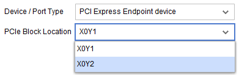
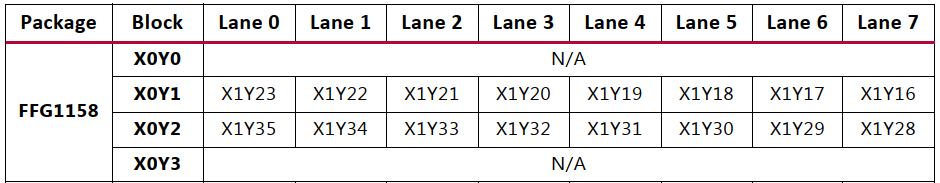

# 项目场景：

已有板卡硬件原理图，在使用`XDMA IP`核时，需要对`PCIe Block Location`选项进行配置。

---

# 问题分析：

`PCIe Block Location`：即`PCIe`接口位置，该选项需要根据原理图，当前FPGA的引脚分配方式，查找官方手册`UG476`和`PG023`来确定。

---

# 解决方案：

1. 在板卡原理图上确认`PCIe`所使用的`bank`,例如：`xc7v550tffg1158`在原理图上使用`bank117`和`bank118`;

2. 查看`UG476`的`Appx. A：Placement Information by Package`中`xc7v550tffg1158`FPGA的`bank117`和`bank118`对应的`GTH CHANNEL`位置，第400页，为`X1Y28`~`X1Y35`;

3. 查看`PG023`第四章`Constraining the Core`目录下的`Transceiver Placement`选项中`550T`的收发器位置，`X1Y28`~`X1Y35`对应`XDMA IP`核的`X0Y2`；

对于不同FPGA，不同的原理图，均可参考该思路。

---

